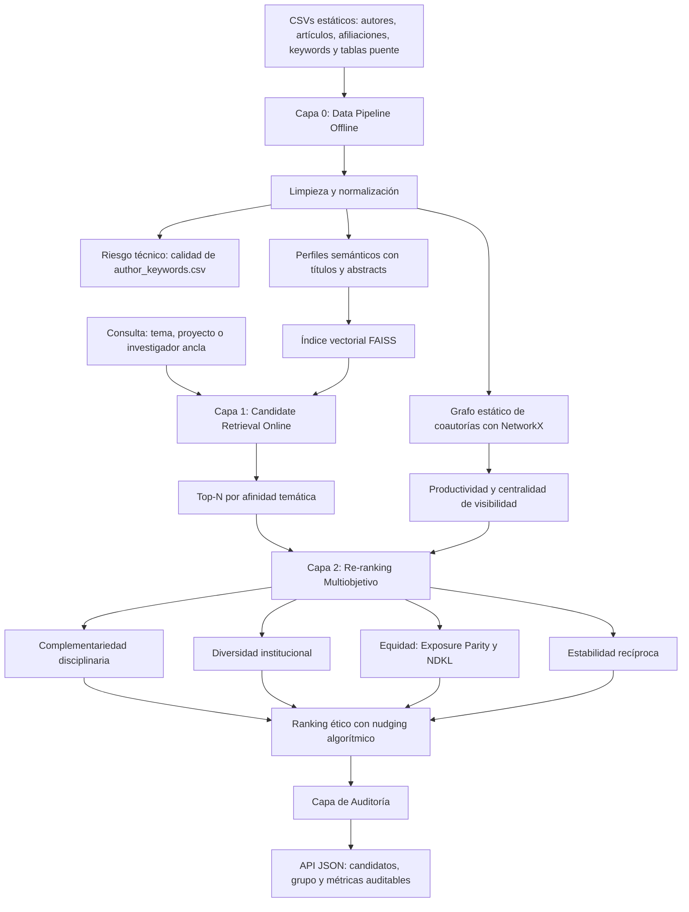

# 1. Definición Operativa de Criterios (Resultado Semana 3)

## 1.1. Fundamentación ética y alcance de los datos

El sistema de recomendación ética de investigadores para la conformación de grupos de investigación en Centinela V3 se construirá sobre datos bibliométricos estáticos disponibles en formato CSV. El conjunto de datos comprende perfiles de autores, artículos científicos, afiliaciones institucionales, palabras clave de autor y tablas puente para relacionar estas entidades.

No se dispone de atributos demográficos sensibles, tales como género o etnia. Por tanto, la dimensión ética no se formulará como una intervención sobre categorías demográficas, sino como una estrategia de auditoría y mitigación de la desigualdad de **visibilidad histórica**. Esta dimensión busca reducir el **sesgo de popularidad** y el **Efecto Mateo**, fenómenos mediante los cuales investigadores con mayor productividad o conectividad acumulada pueden recibir exposición desproporcionada en los resultados. Färber et al. (2021), en *Biases in Scholarly Recommender Systems*, sustentan la necesidad de identificar y controlar estos sesgos en sistemas de recomendación académica.

La visibilidad histórica se operacionalizará mediante dos señales disponibles: el conteo de publicaciones por investigador y la centralidad de grado derivada de la red estática de coautorías. Los investigadores ubicados en los cuartiles inferiores de ambas señales se considerarán el grupo de menor visibilidad para efectos de auditoría de exposición. Esta definición es un proxy técnico y no equivale a una categoría demográfica protegida.

## 1.2. Matriz de Variables y Métricas de Diseño

| Criterio | Definición y variable de entrada (CSV) | Métrica / algoritmo | Justificación teórica |
|---|---|---|---|
| Afinidad temática | Representa la proximidad entre los intereses de investigación de candidatos y la temática de un proyecto o investigador ancla. Se utilizarán títulos y resúmenes de `articles.csv`, asociados a cada investigador mediante las tablas puente disponibles. | Similitud coseno sobre embeddings semánticos densos, producidos con Sentence-BERT o SPECTER. El perfil temático de cada investigador será un centroide ponderado de sus publicaciones; los pesos aplicarán decaimiento temporal para priorizar producción reciente. | Ayala-Tipán et al. (2026), en *From Profiles to Promising Paths*, indican que los embeddings semánticos superan el desacople de vocabulario característico de modelos basados exclusivamente en TF-IDF. |
| Complementariedad disciplinaria | Representa el aporte no redundante de conocimientos y habilidades de un investigador respecto del grupo propuesto. Las variables se obtendrán de los tópicos extraídos y normalizados de `author_keywords.csv`. | Reducción de entropía respecto de la distribución de habilidades objetivo del proyecto y cobertura disciplinaria. La selección favorecerá candidatos que incrementen la diversidad útil del conjunto y reduzcan la redundancia temática. | Andrejczuk et al. (2019), en *STCP*, respaldan la maximización de entropía en equipos como mecanismo para fomentar la diversidad de habilidades. |
| Diversidad institucional | Representa la heterogeneidad de procedencia institucional entre integrantes del grupo. Las instituciones de origen se identificarán desde `affiliations.csv` y sus relaciones con autores y artículos. | Índice de Gini-Simpson aplicado a atributos categóricos de afiliación. Se incorporará un umbral anti-tokenismo: para reconocer representación efectiva de una categoría minoritaria se exigirá m ≥ 2 integrantes del grupo minoritario. | Hui et al. (2025), en LAK 2025, justifican el uso del índice Gini-Simpson y la mitigación del tokenismo en la asignación de equipos. |
| Equidad / mitigación de sesgo | Busca evitar que la recomendación amplifique la concentración histórica de atención en investigadores con mayor producción o conectividad. Se usará la red de coautoría derivada de `articles_authors.csv` y el conteo de artículos por autor. El atributo de control será la visibilidad o popularidad: cuartiles inferiores de productividad y centralidad de grado. | Paridad de exposición (*Exposure Parity*) y NDKL (*Normalized Discounted KL Divergence*). El re-ranking incorporará un mecanismo probabilístico para aumentar la exposición del grupo de visibilidad baja sin eliminar la señal de relevancia. | Loghmani et al. (2026), en *COIN*, fundamentan tratar la popularidad sociométrica como atributo protegido y aplicar *Exposure Parity* mediante re-ranking probabilístico sin perjudicar indebidamente la precisión. |
| Estabilidad de emparejamiento | Representa la correspondencia recíproca entre preferencias de investigadores potencialmente vinculados. La entrada será una matriz de preferencias cruzadas calculada a partir de la afinidad temática. | Media armónica de las preferencias mutuas. Esta función penaliza pares donde una de las partes tiene baja afinidad, incluso si la otra presenta una afinidad elevada. | Palomares et al. (2021), en *Reciprocal Recommender Systems Survey*, justifican el uso de agregación recíproca para prevenir la saturación de solicitudes hacia investigadores más populares. |

## 1.3. Consideraciones de operacionalización

Los criterios no se interpretarán como reglas aisladas. La afinidad temática define una condición mínima de relevancia; la complementariedad e institucionalidad evalúan la calidad colectiva del grupo; y la equidad regula la exposición de perfiles de menor visibilidad histórica. La estabilidad de emparejamiento actúa como señal adicional de compatibilidad mutua.

La disponibilidad de fuentes estáticas implica que las métricas se calcularán sobre una fotografía histórica del ecosistema académico. En consecuencia, los resultados deberán interpretarse como recomendaciones basadas en evidencia bibliométrica disponible y no como evaluaciones definitivas de la capacidad, mérito o idoneidad de una persona investigadora.

# 2. Arquitectura Conceptual del Sistema (Resultado Semana 4)

## 2.1. Enfoque arquitectónico híbrido Two-Stage

La arquitectura conceptual se organiza como un flujo híbrido **Two-Stage**, inspirado en Borges et al. (2021), *Two-Stage Pareto Optimization*. Este enfoque divide el proceso de recomendación en dos etapas en línea con responsabilidades diferenciadas: recuperación eficiente de candidatos relevantes y reordenamiento multiobjetivo con restricciones éticas.

La separación reduce el espacio combinatorio antes de evaluar criterios colectivos complejos. La primera etapa se concentra en relevancia temática y velocidad de recuperación; la segunda incorpora complementariedad, diversidad institucional, visibilidad histórica y estabilidad de emparejamiento. Así, la arquitectura evita aplicar optimización multiobjetivo sobre toda la población de investigadores cuando solo un subconjunto resulta temáticamente pertinente.

## 2.2. Capa 0: Data Pipeline - Offline

La Capa 0 procesa exclusivamente los volcados locales en CSV:

- `authors.csv`, con aproximadamente 39 mil autores.
- `articles.csv`, con aproximadamente 39 mil artículos.
- `affiliations.csv`, con aproximadamente 5,3 mil instituciones.
- `author_keywords.csv`, con aproximadamente 86 mil palabras clave.
- Tablas puente: `articles_authors`, `articles_affiliations` y `articles_author_keywords`.

El pipeline ejecutará extracción, validación, limpieza, normalización e integración de los datos tabulares. Una operación prioritaria será la depuración de las aproximadamente 86 mil entradas de `author_keywords.csv`: se normalizarán mayúsculas y minúsculas, valores nulos, duplicados y variantes textuales. Esta actividad se declara como el principal **riesgo técnico y supuesto** de la arquitectura, debido a que la calidad de las palabras clave condiciona directamente la complementariedad disciplinaria y la cobertura temática.

En esta capa también se construirá un grafo estático de coautorías con NetworkX a partir de `articles_authors.csv`. El grafo permitirá calcular conectividad y centralidad de grado para formar la señal de visibilidad histórica. En paralelo, los títulos y resúmenes de publicaciones se transformarán en embeddings semánticos y se almacenarán en un índice vectorial FAISS. El resultado offline será un conjunto reproducible de perfiles temáticos, atributos institucionales, métricas de visibilidad y estructuras de búsqueda vectorial.

## 2.3. Capa 1: Candidate Retrieval - Online Baseline

La Capa 1 opera en línea como mecanismo base de recuperación de candidatos. Recibe la consulta de recomendación, que puede corresponder a un tema, proyecto o investigador ancla, y la convierte a una representación semántica compatible con el índice FAISS.

La recuperación utiliza exclusivamente la **afinidad temática** para seleccionar los Top-N candidatos con mayor similitud semántica. Esta decisión establece una frontera de relevancia y reduce el espacio de búsqueda antes de generar combinaciones de equipo. La capa no aplica todavía restricciones de equidad, diversidad o complementariedad; su objetivo es producir un conjunto de candidatos eficiente, relevante y suficientemente amplio para el análisis posterior.

## 2.4. Capa 2: Re-ranking Multiobjetivo - Online

La Capa 2 recibe los Top-N candidatos y aplica un motor de re-ranking multiobjetivo. La puntuación final combina la afinidad temática de la Capa 1 con señales de complementariedad disciplinaria, diversidad institucional, visibilidad histórica y estabilidad de emparejamiento.

La equidad se incorpora como una restricción o ajuste explícito de exposición. Los investigadores en cuartiles inferiores de productividad y centralidad podrán recibir un *booster* de exposición controlado, siempre que cumplan el umbral de relevancia temática. Este mecanismo no sustituye la afinidad ni obliga a seleccionar un candidato no pertinente; ajusta el orden de exposición para reducir la reproducción automática del sesgo de popularidad.

El re-ranking aplicará **nudging algorítmico**, conforme a Gómez-Zará et al. (2026), en CSCW/CHI. El nudging reordena las alternativas para hacer visibles opciones valiosas y menos favorecidas históricamente, pero preserva la capacidad de decisión del usuario final. Por tanto, el sistema debe presentar recomendaciones explicables y evitar la imposición determinista de una configuración de grupo.

## 2.5. Capa de Auditoría y salida de la API

La Capa de Auditoría genera una salida JSON que incluye tanto los candidatos recomendados como la evidencia cuantitativa utilizada para construir la recomendación. Para cada grupo propuesto, la respuesta debe incorporar:

- Puntaje de afinidad temática.
- Contribución de complementariedad disciplinaria.
- Indicador de diversidad institucional.
- Grupo o cuartil de visibilidad histórica de cada integrante.
- Métricas de paridad de exposición y NDKL aplicables al ranking.
- Señal de estabilidad de emparejamiento basada en preferencias recíprocas.
- Explicación del ajuste ético aplicado por el re-ranking.

Esta capa proporciona trazabilidad para la evaluación experimental y permite comparar el baseline de afinidad temática con la versión multiobjetivo y ética del recomendador.

## 2.6. Flujo conceptual

